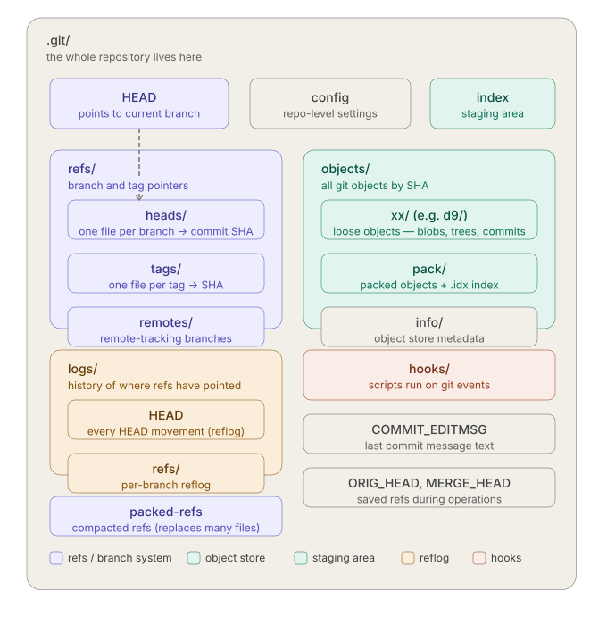
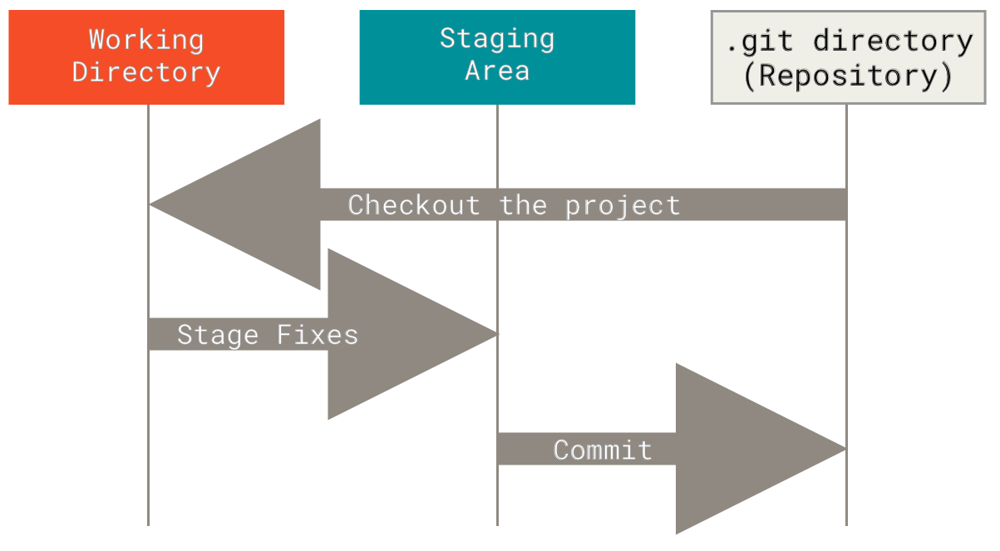
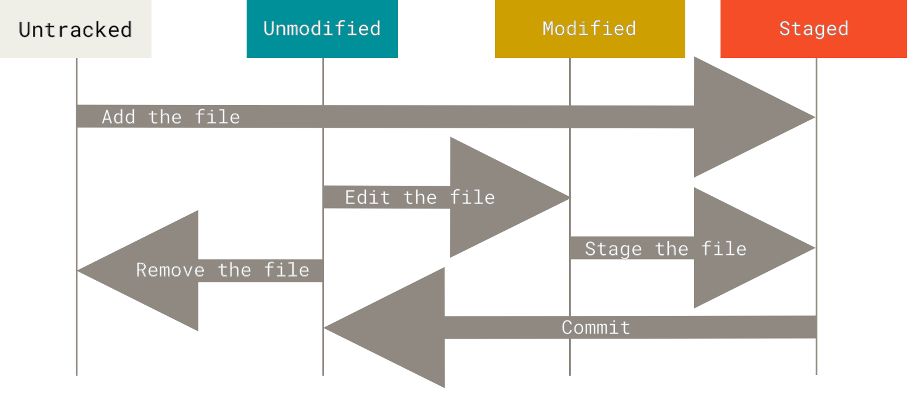

## The book
We will base this introduction on the [Pro git](https://git-scm.com/book/en/v2) book

- Brief history of git, concepts and use cases

- Setup

- Basic usage (add, commit, push, pull, amend, tag)

- Branches

- Merging (fetch, merge, stash, and useful tools for merging)

- Staying away from (or getting into) trouble (rebase and reset)

- Advanced topics
There is also a convenient [cheat sheet](https://git-scm.com/cheat-sheet)

---

## History of git and key concepts

- [Apr 7, 2005]{style="font-size: 70%;"} [Git first commit](https://github.com/git/git/tree/e83c5163316f89bfbde7d9ab23ca2e25604af290) 
[(with the [SHA1 order fix](https://github.com/git/git/commit/d98b46f) on Apr 20 2005)]{style="font-size: 70%;"}


:::: {.columns}
::: {.column width="50%"}
{width="90%"}
:::

::: {.column width="50%"}

:::

::::
<!-- {width="10%"} -->

::: {.notes}
The biggest change from original git to current is the use of "changeset" instead of "commmit",
also "Staging Area" was called "current directory cache", and it constist only in the index that is a list of files!

blob — file content
tree — directory listing (pointers to blobs and other trees)
commit — snapshot in history (points to a tree + parent commit + metadata)
index — not a git object at all, just a mutable working file

in .git/HEAD there is a symbolic reference (or just the filename in detached head state) to the commit file, that otherwise has a long hash as a name

:::

---

## git structure
:::: {.columns}
::: {.column width="50%"}


:::

::: {.column width="50%"}

:::

::::


---

## Setting up git

```bash
git config --global user.name “[firstname lastname]”
git config --global user.email “[valid-email]”
git config --global color.ui auto
```
The commands above pretty much explain themselves, but...

- `--global` writes to `~/.gitconfig` i.e. at user level

- `--system` writes to a system wide configuration file

- `--local` writes to `.git/config`

- Check every command manual for more sub-commands and flags! 

---


## Setting up a repository

### log and status


- status: it shows you your current snapshot
```bash
git status
```

- log: it shows you all the history
```bash
git log
```
    
- [reflog: advanced... tracks every branch head move. For emergencies.]{style=color:grey;}
```bash
git reflog
```


---

## Adding / removing a file

- Before `git add` a file is a new or modified file in [Working Directory]{style="color:red;"}
- When you add it it is added to the [index (a.k.a staging area)]{style="color:blue;"}

```bash
git add <filename>
```

- You can also decide to remove a file from the [index]{style="color:blue;"}

    - it is also deleted in your [Working Directory]{style="color:red;"} unless `--cached` flag is used.
```bash
git rm --cached <filename>
```

- Staged changes are not saved in the [.git directory]{style="background-color: yellow; color: black; padding: 2px;"}
untill committed (more later) 

---

## .gitignore

- `.gitignore file` is used to prevent adding unwanted files
    - autogenerated files
    - binary files
    - directories

- [example](https://github.com/github/gitignore/blob/main/Python.gitignore)

---

## commit

- `commit` is creating a new snapshot in your [.git directory]{style="background-color: yellow; color: black; padding: 2px;"}

```bash
git commit -m "Fixed 41 bugs"
```

- `--amend` flag allows to correct the last commit.

```bash
git commit --amend -m "Fixed 42 bugs"
```

- Omitting `-m` option opens an editor for editing commits

---


## Branches

- branch
```bash
git branch experiment
```

- checkout

- switch

---

## Work with remote

- push

- pull

---

## Tags and Releases

- tag
```bash
git tag -a v1.4 -m "my version 1.4"
```

- Adding assets on GitHub with a release

---


## Merging

- Three way merging
- meld
- Taming Jupyter Notebooks: [nmdime](https://nbdime.readthedocs.io/en/latest/)

---

## Fast forward merge

---

## stash

---

## rebase

---

## reset

---

## How to move from here?

---

## Thanks!

---


---

## My Awesome Research Slide

Here is a chart showing important data.